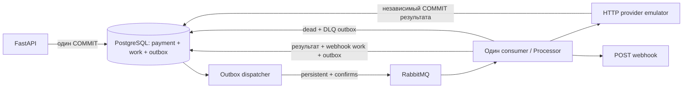

# Асинхронный процессинг платежей

Реализация тестового задания на Python 3.12, FastAPI, Pydantic v2, SQLAlchemy 2 async, PostgreSQL, RabbitMQ/FastStream и Alembic. API принимает платёж, consumer вызывает отдельный HTTP-эмулятор провайдера и доставляет результат клиенту. Создание платежа не зависит от доступности брокера или провайдера.

## Быстрый запуск

Нужны Docker Engine/Desktop и Docker Compose v2. Команды выполняются из каталога проекта.

```powershell
Copy-Item .env.example .env
docker compose up --build -d
docker compose ps
docker compose logs -f api consumer outbox provider webhook-sink
```

В Linux/macOS вместо `Copy-Item` используйте `cp .env.example .env`. Сервис `migrate` применяет миграции и завершается с кодом 0; это ожидаемо. API и фоновые процессы запускаются после миграций. Данные PostgreSQL и RabbitMQ сохраняются в named volumes между перезапусками.

Для RabbitMQ закреплены `hostname: rabbitmq` и `RABBITMQ_NODENAME: rabbit@rabbitmq`: каталог данных зависит от имени узла, поэтому одного volume недостаточно при пересоздании контейнера. Это соответствует [документации официального образа](https://github.com/docker-library/docs/blob/master/rabbitmq/README.md#running-the-daemon).

Если volume уже использовался со старым случайным именем `rabbit@<container-id>`, изменение конфигурации само не переносит прежние очереди в новый каталог. Перед обновлением такого запуска сохраните резервную копию и разберите оставшиеся сообщения под прежним именем узла; не удаляйте volume. Исправление обеспечивает стабильность новых запусков, а не автоматическое восстановление ранее оставленных каталогов.

Адрес API: `http://localhost:8000`. RabbitMQ Management: `http://localhost:15672`, логин/пароль `payments` / `payments`. Это локальная конфигурация для проверки задания. API-ключ по умолчанию `dev-api-key`; его можно изменить через `API_KEY` в `.env`.

### Создание и получение платежа

Пример PowerShell:

```powershell
$headers = @{
    'X-API-Key' = 'dev-api-key'
    'Idempotency-Key' = 'order-001'
}
$request = @{
    amount = '100.00'
    currency = 'RUB'
    description = 'Заказ 001'
    metadata = @{ order_id = '001'; customer = @{ id = 42 } }
    webhook_url = 'http://webhook-sink:8002/webhooks'
}
$body = $request | ConvertTo-Json -Depth 10
$response = Invoke-WebRequest -Uri http://localhost:8000/api/v1/payments `
    -Method Post -Headers $headers -ContentType 'application/json; charset=utf-8' `
    -Body ([Text.Encoding]::UTF8.GetBytes($body))
$response.StatusCode
$payment = $response.Content | ConvertFrom-Json
$payment

Invoke-RestMethod -Uri "http://localhost:8000/api/v1/payments/$($payment.payment_id)" `
    -Headers @{ 'X-API-Key' = 'dev-api-key' }
```

Новый запрос возвращает `202`, например:

```json
{
  "payment_id": "e0c12c32-17de-4bc3-8996-9be0f5c9c48c",
  "status": "pending",
  "created_at": "2026-10-08T12:00:00+00:00"
}
```

Повторите тот же `Invoke-WebRequest`: ответ будет `200` с тем же `payment_id` и текущим статусом (`pending`, `succeeded` или `failed`). Если с прежним ключом изменить описание, сумму, валюту, `webhook_url` или любое значение метаданных, API вернёт `409`. Для нового платежа нужен новый ключ.

`GET /api/v1/payments/{payment_id}` возвращает `200` с полями `payment_id`, `status`, `created_at`, `amount`, `currency`, `description`, `metadata`, `webhook_url`, `processed_at`. Сумма в ответе — строка с двумя десятичными знаками. Неизвестный платёж даёт `404`; отсутствующий или неправильный `X-API-Key` — `401`; ошибки валидации — `422`.

`X-API-Key` обязателен для обоих endpoint API. `/docs`, `/redoc`, `/openapi.json` отключены. Провайдер защищён отдельным `PROVIDER_API_KEY`. `webhook-sink` — отдельная внешняя клиентская заглушка: она принимает POST, пишет уведомление в лог и отвечает `204`.

В Docker `webhook_url` должен быть доступен **из контейнера consumer**. `localhost` внутри контейнера означает сам consumer. Для примера используйте адрес `http://webhook-sink:8002/webhooks`; для приёмника на хосте Docker Desktop — `http://host.docker.internal:ПОРТ/путь`.

### Нормализация и валидация

- `amount` строго больше нуля, диапазон БД `NUMERIC(20,2)`: максимум `999999999999999999.99`.
- Принимаются JSON-число и десятичная строка. `100`, `100.0`, `100.00` и `100.000` эквивалентны; `100.001` отклоняется **без округления**. Незначащие конечные нули не требуют дополнительной точности.
- Валюта нормализуется через удаление внешних пробелов и перевод в верхний регистр; разрешены `RUB`, `USD`, `EUR`.
- URL валидируется и нормализуется Pydantic как HTTP(S) URL. Описание сохраняется без изменения.
- Порядок ключей JSON, в том числе вложенных метаданных, не влияет на сравнение. Числа метаданных сравниваются точно без промежуточного преобразования в `float`; порядок элементов массивов значим.
- Необязательные `description` и `metadata` по умолчанию равны `""` и `{}`. Пропуск поля эквивалентен явному значению по умолчанию. Неизвестные поля запрещены.
- NUL (`\u0000`) и непарные Unicode-суррогаты отклоняются с `422` до SQL. Проверяются строки тела и ключи JSON любой вложенности, а также ключ идемпотентности и идентификатор в GET. Символы не удаляются и не заменяются. Кириллица, emoji, корректные surrogate pairs в JSON, переводы строк и табуляция сохраняются.

## Архитектура и гарантии



### Создание, outbox и повторная доставка

`payments.idempotency_key` имеет уникальное ограничение БД. Платёж, постоянный `provider_key`, `work_items` и исходный `outbox` сохраняются одной транзакцией до внешних вызовов. Конкурентный INSERT с таким же ключом ждёт решения БД, после чего повторный запрос читает существующий платёж и сравнивает весь нормализованный запрос.

Диспетчер читает неопубликованные строки `FOR UPDATE SKIP LOCKED`, отправляет persistent-сообщение и ждёт publisher confirm. Используются `mandatory=True` и `on_return_raises=True`: отсутствие маршрута считается ошибкой. Только после подтверждения заполняется `published_at`. Ошибка брокера откатывает транзакцию, событие остаётся для следующей публикации.

Падение после публикации, но до SQL COMMIT, может вызвать повторную доставку. Это нормальная гарантия **at least once**. `event_id` в теле и AMQP `message_id` остаются прежними. Consumer берёт PostgreSQL advisory lock по событию и проверяет его сохранённое состояние и номер цикла. Уже обработанные, устаревшие и находящиеся в DLQ события не запускают новую оплату. Блокировки SQLite в быстрых тестах действуют только в одном процессе; рабочая конфигурация использует PostgreSQL.

Очереди durable: `payments.new`, `payments.webhook`, `payments.new.dlq`, `payments.webhook.dlq`. Один процесс consumer имеет две подписки, направляющие события в один `Processor`. Платёж и уведомление разделены на этапы с собственными счётчиками.

### Провайдер и ограниченные повторы

Один `provider_key` связан с платежом навсегда: рестарт, повторная доставка и ручное восстановление не создают новый ключ. Эмулятор работает отдельным HTTP-сервисом и фиксирует окончательный результат своей транзакцией в `provider_operations` **до ответа consumer**. Общий PostgreSQL используется для удобства запуска, транзакция провайдера независима от транзакции consumer.

Новый вызов занимает 2–5 секунд. Вероятности: 90% — `succeeded`, 5% — временная ошибка, 5% — окончательный `failed`. Окончательный результат сохраняется и возвращается при повторе того же ключа без новой операции и без новой случайной эмуляции. Временная ошибка в `provider_operations` не записывается. Несовпадающие данные под уже использованным ключом провайдера отклоняются.

На временные ошибки выделено **3 попытки всего**: первая сразу, вторая после 1 секунды, третья после 2 секунд. Окончательный отказ сразу устанавливает `failed` и создаёт webhook; повторной оплаты нет. После трёх временных сбоев событие переходит в DLQ, платёж остаётся `pending`: неопределённость нельзя выдавать за окончательный отказ. Если провайдер уже завершил операцию, но consumer упал до сохранения ответа, последующий вызов с прежним ключом получает первоначальный результат.

### Webhook

После окончательного результата платёж и новое webhook-событие сохраняются одной транзакцией. Неизменяемое тело уведомления хранится в `work_items.payload`:

```json
{
  "event_id": "b3db05bd-aaec-42c0-b3da-ab74d17f75c7",
  "payment_id": "e0c12c32-17de-4bc3-8996-9be0f5c9c48c",
  "status": "succeeded",
  "amount": "100.00",
  "currency": "RUB",
  "processed_at": "2026-10-08T12:00:03+00:00"
}
```

Метод `POST`, успех — любой `2xx`, общий таймаут попытки — 5 секунд. Остальные HTTP-ответы и ошибки транспорта вызывают повтор только уведомления. Всего 3 попытки, задержки перед повторами 1 и 2 секунды. После третьей неудачи webhook попадает в `payments.webhook.dlq`; статус платежа сохраняется. `event_id` и всё содержимое повторных уведомлений, включая `processed_at`, неизменны. `event_id` webhook отличается от ID первоначального события оплаты.

Получатель webhook должен дедуплицировать свои бизнес-действия по `event_id`: HTTP-ответ может потеряться после того, как клиент уже обработал уведомление.

### Принятые технические допущения

Два правила о счётчиках и ручном запуске были предложены в дополнениях, но отдельно не согласованы. В реализации они приняты как **технические допущения**, необходимые для предсказуемого поведения после сбоев:

1. Автоматический счётчик и `not_before` сохраняются в БД. Попытка резервируется отдельным COMMIT **до внешнего вызова**. Падение процесса после резервирования консервативно расходует попытку, даже если неизвестно, успел ли начаться запрос. После рестарта лимит не сбрасывается; сохранённая задержка соблюдается. Если зарезервирована третья попытка, а достоверный результат не сохранён, автоматическая обработка переводится в DLQ. Платёж остаётся `pending` до ручного выяснения результата.
2. Ручной `replay` увеличивает `cycle`, обнуляет `attempts` и начинает новый цикл из максимум трёх попыток. Идентификаторы событий, содержимое webhook и ключи провайдера не меняются. Сообщения старых циклов игнорируются.

Резервирование ограничивает число обращений даже при падении процесса в неудобный момент. Это сознательный компромисс: неопределённая попытка может потребовать ручного восстановления раньше, чем произойдут три фактических HTTP-вызова.

## Ручное восстановление из DLQ

Административного HTTP-endpoint нет. Источник состояния для восстановления — `work_items` в БД, а не число сообщений в RabbitMQ.

```powershell
docker compose exec api python -m app.recover list
docker compose exec api python -m app.recover replay EVENT_ID
docker compose logs -f consumer outbox webhook-sink
```

`list` показывает `event_id`, `payment_id`, `stage`, `cycle`, `attempts`, `last_error` всех этапов в состоянии `dead`. Сначала восстановите доступность провайдера или приёмника webhook, затем передайте точный `event_id` в `replay`.

`replay` блокирует строку в БД, проверяет `state=dead` и одной транзакцией создаёт новый цикл и outbox. Повтор команды до завершения этого цикла отклоняется. При следующем исчерпании попыток тот же этап снова появится в `list`.

- `stage=payment`: повторяется обращение к провайдеру с исходным ключом. Существующий результат провайдера будет получен повторно.
- `stage=webhook`: восстанавливается только доставка сохранённого уведомления. Завершённый платёж и ключ провайдера не меняются, оплата не запускается.

Старые сообщения в `.dlq` остаются для аудита и могут быть опубликованы даже после ручного восстановления, если брокер ранее был недоступен. Они содержат прежний `cycle` и не означают, что текущий цикл снова завершился ошибкой. Не используйте RabbitMQ «Move/requeue» как способ восстановления: это не сбрасывает сохранённый лимит попыток. После нужной проверки старые копии можно удалить средствами RabbitMQ; на состояние платежа это не влияет. Некорректные сообщения, вручную отправленные в рабочую очередь без записи `work_items`, относятся к транспортной DLQ и через CLI платежей не восстанавливаются.

### Проверка отказов вручную

Недоступность брокера:

```powershell
docker compose stop rabbitmq
# Отправьте новый POST с новым Idempotency-Key: ожидается 202.
docker compose exec postgres psql -U payments -d payments -c "SELECT event_id, destination, cycle, published_at FROM outbox ORDER BY created_at DESC LIMIT 10;"
docker compose start rabbitmq
docker compose logs -f outbox consumer
```

У исходного события до восстановления `published_at` будет `NULL`; после подтверждённой публикации оно заполнится.

Ошибка webhook и восстановление:

```powershell
docker compose stop webhook-sink
# Создайте новый платёж с новым ключом и прежним URL /webhooks.
# Дождитесь завершения оплаты и трёх неудачных доставок уведомления.
docker compose exec api python -m app.recover list
docker compose start webhook-sink
docker compose exec api python -m app.recover replay EVENT_ID_СО_STAGE_WEBHOOK
docker compose logs webhook-sink
```

Платёж уже будет иметь `succeeded` или `failed`; восстановление webhook не изменит этот статус. Если сам провайдер случайно исчерпал временные ошибки, сначала восстановите его этап, затем при необходимости webhook.

## Отличия от первоначального PDF

| Первоначальное требование | Реализация и причина |
| --- | --- |
| Только ответ `202` на создание | Новый запрос — `202`, одинаковый повтор — `200` с текущим статусом, конфликт данных — `409`, как требуют дополнения. |
| 90% успеха / 10% ошибки | 90% успеха / 5% временного сбоя / 5% окончательного отказа; только временный сбой повторяется. |
| Consumer делает всё в одном проходе | Один процесс и общий Processor, но отдельные сохраняемые этапы оплаты и webhook: ошибка уведомления не повторяет оплату. |
| Таблицы `payments`, `outbox` | Добавлены `work_items` для постоянных ID, лимитов и восстановления, `provider_operations` для независимой идемпотентности эмулятора. Миграции создают все четыре таблицы. |
| Retry и DLQ после трёх попыток | У каждого этапа собственные три попытки, задержки 1 и 2 секунды; `dead` и DLQ-outbox фиксируются атомарно. |
| Эмуляция внутри consumer | Отдельный HTTP-процесс провайдера позволяет проверить потерю ответа после фиксации операции, не теряя результат при падении consumer. |
| Compose с API и consumer | Добавлены процессы outbox, provider, одноразовый migrate и клиентский webhook-sink; PostgreSQL и RabbitMQ сохраняют данные в volumes. |
| Поведение после рестарта/ручного запуска не задано | Сохраняемые счётчики и новый ограниченный ручной цикл приняты как технические допущения; объяснение выше и в комментариях к коду. |

## Тесты

Быстрые детерминированные тесты используют SQLite, HTTP-моки и фиктивный publisher. Они проверяют API, нормализацию, ограничения суммы, конкуренцию, независимый результат провайдера, повторные доставки, границы вероятностей, лимиты попыток, неизменность webhook, outbox при потере подтверждения и ручное восстановление. SQLite-проверки не заменяют проверку PostgreSQL-блокировок и настоящего AMQP.

```powershell
python -m venv .venv
.venv\Scripts\Activate.ps1
python -m pip install -c requirements-dev-lock.txt -e ".[test]"
python -m pytest -q -m "not integration"
```

В Linux/macOS активируйте окружение командой `source .venv/bin/activate`. Для тестов без локального Python:

```powershell
docker compose --profile test run --build --rm tests pytest -q -p no:cacheprovider -m "not integration"
```

Интеграционные тесты требуют реальных PostgreSQL и RabbitMQ. Профиль `test` передаёт адреса в `TEST_DATABASE_URL` и `TEST_RABBITMQ_URL`:

```powershell
docker compose --profile test run --build --rm tests pytest -q -p no:cacheprovider -m integration
```

Без этих переменных тесты интеграции пропускаются. Они создают собственные случайные схемы PostgreSQL и очереди RabbitMQ, не очищая рабочие таблицы и очереди. Для проверки вручную используйте сценарии отказов выше. В `.github/workflows/tests.yml` добавлен запуск всего набора через Docker Compose.

Полный набор прошёл в [GitHub Actions, run 37817615639](https://github.com/IOIMIOI/payment_service/actions/runs/37817615639) на коммите [`f51d99d59ab2a4db9699379dab8244f9adbd499c`](https://github.com/IOIMIOI/payment_service/commit/f51d99d59ab2a4db9699379dab8244f9adbd499c): **151 passed in 4.57s**, без пропусков, в одном прогоне с PostgreSQL и RabbitMQ. Запуск завершился успешно 8 октября 2026 года; результат pytest записан в 20:35:40 МСК. В том же CI прошла отдельная регрессия сохранности RabbitMQ после настоящего `down` → `up`. Использованы Docker-образы `postgres:16-alpine` и `rabbitmq:4-management-alpine` из Compose; точные patch-версии серверов в журнале не выводились.

До CI локально прошли **150 проверок** с PostgreSQL 16.9 и отдельно **1 интеграционная проверка** с RabbitMQ 4.3.6. Проверены конкурентное создание платежа, блокировки провайдера/consumer между независимыми соединениями, публикация с потерей SQL-коммита после broker confirm и повторная AMQP-доставка. `alembic upgrade head` и `alembic check` подтвердили соответствие схемы моделям; Ruff и форматирование прошли. Результаты и места для пользовательских скриншотов собраны в [TEST_REPORT.md](TEST_REPORT.md). Описанный там HTTP smoke выполнен ранее на уже запущенном локальном стеке и не подтверждает обновление этого стека до проверенного в CI коммита.

Отдельная регрессия сохранности сообщений при пересоздании контейнера:

```powershell
python scripts/check_rabbitmq_persistence.py
```

Скрипт использует конфигурацию RabbitMQ из текущего `compose.yaml`, создаёт отдельный случайный Compose project, собственный volume и свободный порт. В durable-очередь отправляется persistent-сообщение; затем выполняется настоящий `down` → `up` без удаления volume. Проверяются смена container ID, прежнее имя узла и volume, неизменные ID и данные непрочитанного сообщения. После теста удаляется только временный проект с его volume. Скрипт не пересоздаёт рабочие контейнеры.

Для воспроизведения исходного дефекта в том же изолированном окружении:

```powershell
python scripts/check_rabbitmq_persistence.py --negative-control
```

В этом режиме hostname/nodename убираются только из временной конфигурации; ожидается код выхода `1` и сообщение о недоступности прежней очереди после пересоздания. Отрицательный контроль запускается отдельно. Обычный режим **прошёл в GitHub Actions** в [указанном запуске](https://github.com/IOIMIOI/payment_service/actions/runs/37817615639): контейнер сменился, узел `rabbit@rabbitmq`, volume и непрочитанное сообщение сохранились. Локально этот Docker-тест выполнить не удалось из-за запрета доступа к `dockerDesktopLinuxEngine`; подтверждение его прохождения получено в CI.

`requirements-lock.txt` фиксирует установленные версии runtime-зависимостей и их транзитивных зависимостей; `requirements-dev-lock.txt` добавляет тестовые инструменты и Ruff. Docker использует эти файлы как pip constraints. Это фиксация версий Python-пакетов, а не lock с хешами всех платформенных wheel или digest базовых образов. Используется обычный Uvicorn с HTTP/h11: дополнительные `uvloop`/`httptools` не требуются и не устанавливаются из непроверенного Linux-only extra.

Проверка стиля:

```powershell
python -m pip install -c requirements-dev-lock.txt -e ".[test,dev]"
python -m ruff check .
python -m ruff format --check .
```

## Локальный запуск процессов

После установки зависимостей можно использовать контейнеры только для инфраструктуры:

```powershell
docker compose up -d postgres rabbitmq
python -m alembic upgrade head
```

В отдельных терминалах с активированным окружением:

```text
uvicorn app.api:app --host 0.0.0.0 --port 8000
uvicorn app.provider:app --host 0.0.0.0 --port 8001
uvicorn app.webhook_sink:app --host 0.0.0.0 --port 8002
python -m app.outbox
python -m app.consumer
```

Для локального consumer в примере платежа используйте `http://localhost:8002/webhooks`. Значения `.env.example` рассчитаны на localhost; Compose сам заменяет адреса PostgreSQL, RabbitMQ и provider именами контейнеров.

Основные настройки: `DATABASE_URL`, `RABBITMQ_URL`, `API_KEY`, `PROVIDER_URL`, `PROVIDER_API_KEY`, `PROVIDER_DELAY_MIN`, `PROVIDER_DELAY_MAX`, `OUTBOX_POLL_INTERVAL`. Задержки провайдера в рабочем примере — 2–5 секунд. Ограничения в три попытки, задержки 1/2 секунды и таймаут webhook 5 секунд зафиксированы в коде согласно дополнениям.

Остановка без удаления сохранённых данных:

```powershell
docker compose down
```

## Проверка вручную и отчёт

Два сценария основного функционала с готовыми командами `curl.exe` приведены в [examples/CURL.md](examples/CURL.md). После запуска стека их можно выполнить автоматически из PowerShell:

```powershell
.\examples\smoke.ps1
```

Фактические результаты автоматических проверок и HTTP-сценариев записаны в [TEST_REPORT.md](TEST_REPORT.md). В отчёте оставлены места для скриншотов; добавьте изображения в каталог `screenshots/` и раскомментируйте соответствующие ссылки.

## Структура проекта

```text
app/api.py           HTTP API и атомарное создание платежа
app/schemas.py       точный JSON, валидация и канонизация
app/models.py        четыре таблицы и ограничения
app/db.py            async sessions и блокировки
app/worker.py        состояния этапов, попытки, финализация и DLQ
app/provider.py      HTTP-клиент и независимый эмулятор
app/webhook.py       POST-адаптер с таймаутом
app/broker.py        durable топология и publisher confirms
app/outbox.py        повторяемая публикация
app/consumer.py      подписки FastStream
app/recover.py       ручной list/replay
app/webhook_sink.py  клиентский приёмник для примера
alembic/             миграции
tests/               автоматические проверки
```
